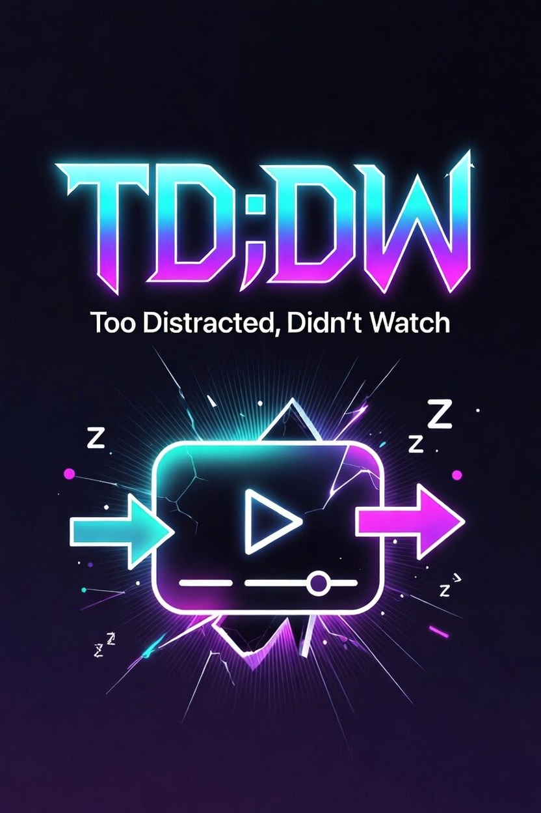
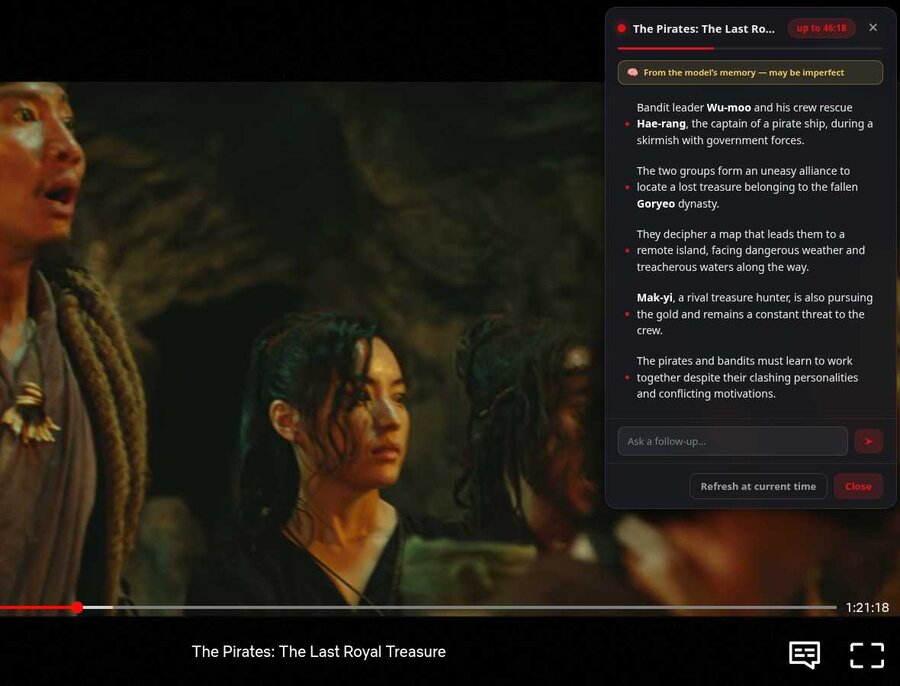
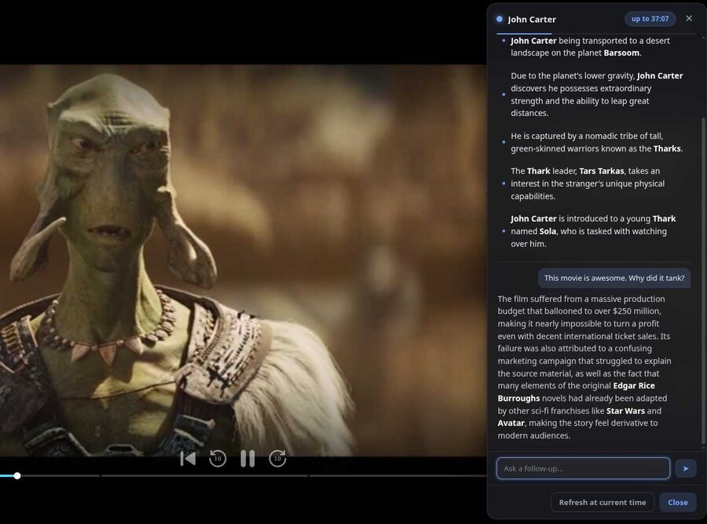

  
  <h1>TD;DW</h1>
  
<strong>Too Distracted, Didn't Watch.</strong> Spoiler-free "what did I miss?" for the video you're already watching.

Activate it mid-video and you get a recap of everything that happened **up to your current
timestamp**, and nothing past it. Works on YouTube, Netflix, Prime Video, Disney+, and your own
**Jellyfin** server. There's also a follow-up question box, so when the recap leaves you going
"wait, who's that guy again?" you can just ask, without leaving the page and losing your spot.

I built this because I kept pausing shows to go "hang on, what did I miss," then falling into a
twenty-minute Wikipedia hole and forgetting what I was watching. Now I hit a shortcut and get on
with it. Full disclosure: it's a joint project with Claude (Anthropic's AI), and I'm happy to say
that out loud.

  
    
  
  
<em>Left to its own: a spoiler-free recap up to where you paused. Ask a follow-up and it
  answers right in the panel.</em>

## Before you start (read this first)

- **You need an LLM endpoint.** Pick a provider in the extension options:
  - **OpenRouter**: one key, every model.
  - **Google Gemini (AI Studio)**: uses your [AI Studio](https://aistudio.google.com/apikey)
    key via Google's OpenAI-compatible endpoint. Handy if you've got AI Studio credits sitting there.
  - **Custom / Local**: any OpenAI-compatible endpoint (Ollama, LM Studio, llama.cpp).
- **Model choice matters most in knowledge mode.** For titles TD;DW recaps *from the model's
  own memory* (Netflix/Disney, or a Jellyfin item with no subtitles), small models hand you vague,
  plot-shaped filler, so reach for a stronger model there. **Transcript mode** (YouTube captions,
  Jellyfin subtitles) feeds the model the real dialogue, so it stays accurate even on cheap, fast
  models and even for brand-new or obscure content. The default model is now
  `google/gemini-3.8-flash` (or `gemini-3.8-flash` on the Gemini preset). Thinking effort is tuned
  per task: low in transcript mode (summarizing captions gains nothing from extra thinking),
  medium in knowledge mode (identifying the work and judging what's happened before your timestamp
  benefits from it), and this is applied automatically on OpenRouter and Gemini, whichever you pick.
- **Every recap tells you where it came from.** A badge at the top reads **green, "Built from
  this title's subtitles"** (grounded, trustworthy), **amber, "From the model's memory, may be
  imperfect"** (recalled from training, so treat it as a refresher), or the in-between **"From
  memory, anchored by subtitles from 12:30 on"** (see the next bullet). It's an honest signal, not
  a made-up confidence score.
- **Turn subtitles on for Netflix, Prime Video and Disney+.** Those players never hand over a
  subtitle file, but they do paint each line on screen, and TD;DW quietly collects the lines it
  sees from the moment the tab loads. It can't recap from those alone (it only has what you've
  watched in this tab), so it uses them to pin down exactly where you are in the story, which is
  the thing memory-only recaps get wrong, and grounds the most recent bullets in real dialogue.
  Subtitles off means memory only, and the badge says so. A very long transcript gets sampled down to fit the configured
  budget rather than sent whole, and when that happens the badge adds "(sampled to fit)" so you
  know the recap is grounded but not complete. Tune how much subtitle text gets sent with the
  **Transcript size** option (Standard for cloud models, Local for small-context local ones).
- **The keyboard shortcut can silently collide** with an existing binding, so check or change it
  at `chrome://extensions/shortcuts` (Firefox: `about:addons` → gear → Manage Extension Shortcuts).
- **Disney+ (ad tier):** playback position is read from the player's own scrub bar, because the
  raw video stream has stitched-in ads. If you get "couldn't read the playback position," wave your
  mouse over the player so the controls appear, then hit "Refresh at current time".

## Install

Start with `scripts/build.sh` (needs Node). It writes both browser builds:

    scripts/build.sh

Same code either way, only the manifest differs. There are four `manifest.json` files in this
repo and picking the wrong one is the classic mistake, so, plainly:

| File | What it is |
| --- | --- |
| `manifest.json` (repo root) | Chrome **source** manifest. Do not load this folder. |
| `firefox/manifest.json` | Firefox **source** manifest. Do not load this folder either. |
| `dist/chrome/` | **Load this in Chrome, Edge, Brave.** |
| `dist/firefox/` | **This is the Firefox one.** Loaded temporarily, or signed into an `.xpi`. |

Neither browser refuses the other's build. Chrome loads `dist/firefox/` and silently runs with no
background at all; Firefox loads the Chrome manifest and complains that
`background.service_worker` is disabled. If the extension looks broken the moment you install it,
check this first.

**Chrome / Edge / Brave**

1. `chrome://extensions` → enable **Developer mode** → **Load unpacked** → pick **`dist/chrome/`**.
2. Open the extension's **Details → Extension options**, choose your provider, paste your API
   key (or local endpoint URL), **Test connection**, **Save**.

Re-run `scripts/build.sh` after editing source, then hit reload on the extension card.

**Firefox 140+, permanent install (recommended)**

Release and Beta Firefox only install add-ons that Mozilla has signed, and a temporary add-on
disappears the moment you close the browser, taking your saved API key with it. To get one that
sticks, sign it once through your own AMO account on the **unlisted** (self-distribution) channel.
Unlisted means Mozilla runs automated review, signs the file, and hands it back to you: nothing is
published, nothing is searchable, nobody else can install it from addons.mozilla.org.

1. Create AMO API credentials at <https://addons.mozilla.org/developers/addon/api/key/> (the
   account needs two-factor auth), and save them outside the repo:

       mkdir -p ~/.config/td-dw
       cat > ~/.config/td-dw/amo.env <<'KEYS'
       export WEB_EXT_API_KEY="user:12345678:123"
       export WEB_EXT_API_SECRET="the long secret, shown only once"
       KEYS
       chmod 600 ~/.config/td-dw/amo.env

   Both values are required: the **JWT issuer** (`user:...:...`) and the **JWT secret**. Check the
   file with `scripts/check-amo-creds.sh`, which validates the shape without printing the values.

2. Run `scripts/sign-firefox.sh`. It builds, lints, uploads, waits for Mozilla's automated
   signing, and writes the signed file to **`dist/signed/`**.
3. Copy that one `.xpi` to whichever machine you want it on. In Firefox: `about:addons` → gear
   icon → **Install Add-on From File** → pick the `.xpi`. It survives restarts.
4. `about:addons` → TD;DW → **Options** to set up your provider. Keyboard shortcuts live under
   `about:addons` → gear icon → **Manage Extension Shortcuts**.

AMO will not sign the same version number twice, so before each re-sign run
`scripts/bump-version.sh patch`, which bumps both manifests together.

**Firefox, temporary install (for a quick look)**

1. `about:debugging` → **This Firefox** → **Load Temporary Add-on** → pick
   **`dist/firefox/manifest.json`**.
2. It is gone the next time Firefox starts. That is Firefox's rule for unsigned add-ons, not a bug
   in TD;DW. For anything you want to keep, use the signed route above.

More detail in [firefox/README.md](firefox/README.md).

## Use

- On a supported watch page: click the toolbar icon or press **Alt+Shift+U**.
- The video pauses (you can turn that off) and an overlay shows bullet points covering everything
  up to the current time. In transcript mode, click a bullet's time chip to jump the video to that
  moment.
- **Got a question about the recap?** Type it into the follow-up box at the bottom of the panel
  and ask away. It remembers the back-and-forth while the panel is open and forgets it the moment
  you close it, so nothing is saved. Answers stay spoiler-free by default, same as the recap; if
  you'd rather they fill in the whole picture (even past where you are), turn off **"Keep follow-up
  answers spoiler-free"** in options.
- Keep watching, then hit **Refresh at current time** to extend the recap.
- **Recap source** in options controls where the recap comes from: Auto (the default, subtitles
  when the site adapter supplies them, otherwise the model's memory), or force one mode or the
  other to compare the two on the same title.

### Jellyfin

Point TD;DW at your Jellyfin web UI in options (**Jellyfin server URL**, e.g.
`http://jellyfin.local:8096`) and **reload the Jellyfin tab**. It runs on the Jellyfin page itself,
reads your logged-in session token from the page (no separate API key), and pulls the item's
**subtitle track up to your timestamp** for a transcript-grade recap of anything in your library,
movies included. Items with only image-based subs (PGS/VOBSUB) or no subs fall back to knowledge
mode automatically.

## Permissions & privacy

**What it sends, and where.** TD;DW has no backend, no analytics, no telemetry. The only things
that leave your machine are the recap request (the title, plus in transcript mode the subtitles,
or on Netflix/Prime/Disney+ the subtitle lines this tab has shown on screen,
up to your current timestamp) and any follow-up questions you type along with the recap they're
about. All of it goes **only to the LLM endpoint you configure, with your own API key**. Nothing
is logged, and nothing phones home. (The one extra outbound header is an `HTTP-Referer`/`X-Title`
on OpenRouter requests, which OpenRouter uses for app attribution; it says nothing about you.)

**Why the permissions look the way they do:**

- **`storage`**: saves your settings (provider, model, Jellyfin URL) in `chrome.storage.local`.
  Your API key lives here and never leaves except as the `Authorization` header to *your*
  endpoint.
- **`contextMenus`**: adds a "TD;DW settings" item to the toolbar icon's right-click menu.
- **`scripting`**: registers the Jellyfin adapter on your server's own origin at runtime (that
  address isn't known at build time, so it can't be a static entry).
- **Default site access is deliberately minimal.** The extension only auto-runs on
  **YouTube, Netflix, Prime Video, and Disney+** (the `content_scripts` block in the manifest),
  plus `openrouter.ai` for the default provider. That's it on install.
- **The broad optional host permission (`https://*/*`, `http://*/*`) is _not_ granted on
  install.** It's there so that *if* you point TD;DW at a custom LLM endpoint or your own Jellyfin
  server, it can request access to **that one origin**. You get the normal Chrome prompt for the
  specific host, nothing wider. Stick to OpenRouter/Gemini on the built-in sites and it's never
  requested.

**Honest caveats:**

- In transcript mode your subtitles (and any follow-up questions) are sent to a third-party model;
  in knowledge mode it's just the title and your questions. Either way, a cloud LLM sees whatever
  you send it, so pick an endpoint you trust, or run a local one.
- Follow-up questions resend the recap and, in transcript mode, the transcript each time, so a
  long back-and-forth on a long video costs more tokens than a single recap. A non-issue on cheap
  models, worth knowing on pricey ones.
- YouTube captions are fetched through YouTube's internal InnerTube API, which is a technique, not
  an official or supported endpoint, so that path can break when YouTube changes things.

## Architecture (for future me)

- **Content scripts share `globalThis.TDDW`** (no build step); the manifest loads them in
  dependency order. The overlay is a closed-shadow-DOM panel that never passes LLM output through
  `innerHTML`. (CSS class prefix is `cmu-`, and the config storage key is `catchMeUpConfig`; both
  legacy names, kept on purpose to avoid churn and settings loss.)
- `content/adapters/`: one adapter per site behind a common interface: `matches(location)`,
  `getVideoState()` → `{service, title, episodeInfo, currentTimeSeconds, durationSeconds}`, and
  optional `getTranscriptUpTo(seconds, maxChars)` → `{text, language, autoGenerated, truncated}`. Whether
  `getTranscriptUpTo` exists is what routes a site into transcript mode. `index.js` is a
  first-match registry over `matches()`.
  - **Netflix/Prime/Disney** share the `dom-video-adapter.js` factory, so a new streaming site is
    about 30 lines of config. Site DOM fragility stays in each site's `readTitle` / `readPlayerTime`
    / `captionSelectors`. `caption-capture.js` watches the site's on-screen caption container with
    a MutationObserver from page load and turns the cues seen into a *partial* transcript
    (`partial: true`, plus `coverageStartSeconds`). Cue times are stored as stream time and
    converted at read time, so the Disney+ ad tier's inflated clock still filters correctly.
  - **YouTube** fetches captions via the InnerTube ANDROID-client route (web `timedtext` is
    proof-of-origin-gated and returns empty bodies). Lines carry `[m:ss]` prefixes that become
    seekable chips.
  - **Jellyfin** (`jellyfin.js` + `jellyfin-subtitles.js`) talks to the Jellyfin REST API
    same-origin: it resolves the playing item, filters to text subtitle streams
    (`IsTextSubtitleStream`, skipping image subs), fetches `Stream.vtt`, and clips cues past the
    timestamp. It's injected via **dynamic `chrome.scripting.registerContentScripts`** keyed off the
    configured server URL (the static `content_scripts` block can't know it at build time), and
    registration is synced on save / install / startup.
- **Title fallback chain**: site DOM selectors, then Media Session metadata (mirrored from the
  page's main world by `content/main-world/media-session-probe.js`, which survives player
  redesigns), then site-specific extras (Disney uses the tab title; Jellyfin uses item metadata
  from the API).
- **Position**: `video.currentTime`, except on ad-stitched players. The Disney+ ad tier reports
  `duration: Infinity` and stream time that includes ads, so those set `playerTimeOnly` and read
  the player UI's Timeline slider via `TDDW.queryDeepAll()`, which pierces open shadow DOM and
  same-origin iframes.
- `background/providers/`: recap engines behind `pickProvider()`. It picks **transcript** when the
  adapter supplied a full caption/subtitle track, **hybrid** when it supplied a partial one captured
  live off a DRM player, and **knowledge** otherwise. Each result carries a `source`
  field the overlay renders as the provenance badge. Follow-up questions run through
  `buildQuestionMessages` in the same folder, reusing the recap (and transcript, when present) as
  context. Adding an engine is one file plus one registry line.
- `background/providers/prompts.js`: all the spoiler-safety and identification rules. Iterate here;
  it is the product.
- `background/llm-client.js`: a single OpenAI-compatible client (`{baseUrl, apiKey, model}`),
  fetched straight from the MV3 background script, and it strips `<think>` blocks from local reasoning
  models. OpenRouter, Gemini, and local endpoints all speak this one protocol. It also sends
  provider-specific reasoning-effort settings (OpenRouter, Gemini) and falls back without them on a
  400.

## Roadmap

- Polish pass: shortcut-collision check, options UX.
- Publish to the Chrome Web Store. The developer account exists and
  `dist/td-dw-chrome.zip` is upload-ready; the listing itself (screenshots, privacy policy,
  permission justifications) is drafted in [docs/store-listing-answers.md](docs/store-listing-answers.md)
  but not submitted. Chrome has no equivalent of Firefox's unlisted self-distribution: it blocks
  `.crx` installs from outside the store, so the store is the only realistic route.
  (Firefox is done: `scripts/sign-firefox.sh` produces a Mozilla-signed `.xpi` through AMO's
  unlisted channel, so it installs permanently.)
- A public AMO listing for Firefox, which needs a privacy policy and reviewer notes explaining
  how to test without an API key. See [firefox/README.md](firefox/README.md).
- Self-hosted auto-updates for the signed Firefox build: an `updates.json` on GitHub Pages plus
  `update_url` in the Firefox manifest, so a new version arrives on its own instead of being
  hand-copied between machines.

## Development

`npm test` runs the parser and prompt tests (no browser needed). `scripts/build.sh` runs them
again before assembling either browser build, so a broken test fails the build rather than
shipping quietly.

## Credits

- YouTube caption retrieval is adapted from the technique in the open-source
  [`youtube-transcript`](https://www.npmjs.com/package/youtube-transcript) package (MIT), the
  InnerTube ANDROID-client recipe, reworked here for a browser content-script context.

## License

[MIT](LICENSE) © 2026 Marc Tooze. You bring your own LLM endpoint and API key; TD;DW never ships
or proxies one.

Not affiliated with, endorsed by, or connected to YouTube, Netflix, Prime Video, Disney+,
Jellyfin, or any LLM provider. All trademarks belong to their respective owners.
